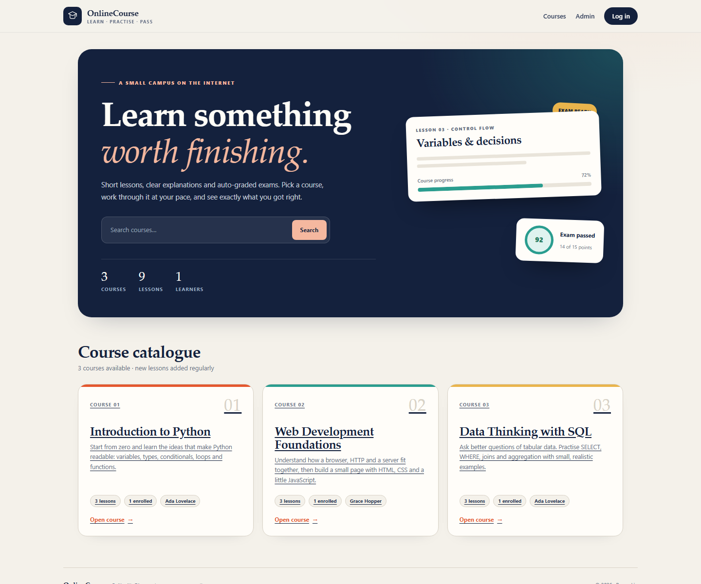
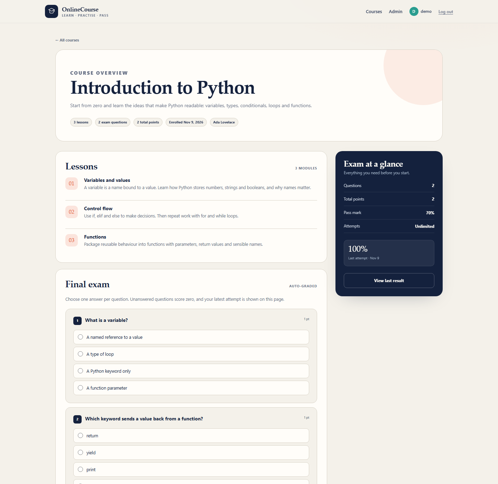
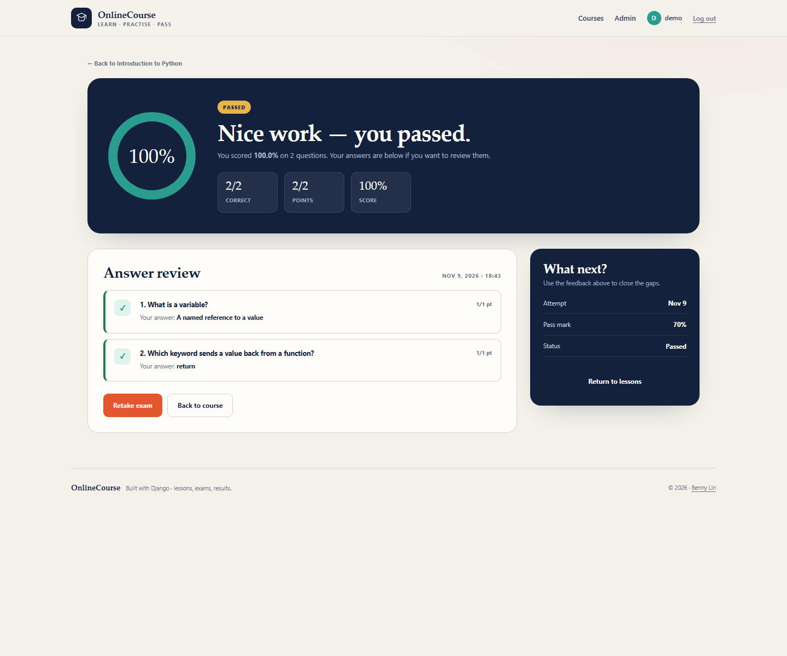
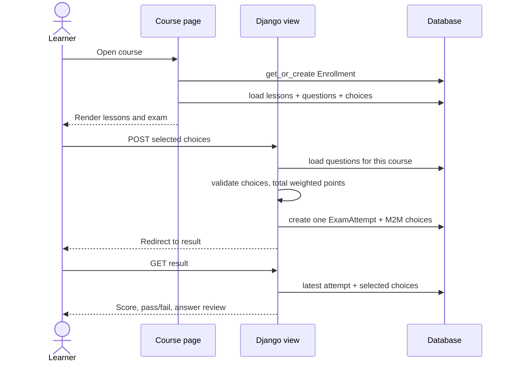

<div align="center">

# 🎓 OnlineCourse

**A small, focused online-course platform: lessons, an auto-graded final exam and a result page that actually explains your answers.**

[](https://www.djangoproject.com/)
[](https://www.python.org/)
[](https://www.sqlite.org/)
[](.github/workflows/django.yml)
[](#-testing)
[](LICENSE)

[**Open the project**](https://github.com/BennyLinntu/django-online-course-project) ·
[**Report a bug**](https://github.com/BennyLinntu/django-online-course-project/issues)

</div>

---

## 🖼️ Preview

<div align="center">
  
  <p><em>A warm, editorial course catalogue with live stats and search.</em></p>
</div>

<table>
<tr>
<td width="50%"></td>
<td width="50%"></td>
</tr>
<tr>
<td align="center"><em>Lessons and a single-choice exam.</em></td>
<td align="center"><em>Score, pass/fail and per-question review.</em></td>
</tr>
</table>

---

## ✨ Features

| | Feature | Details |
|---|---|---|
| 📚 | **Course catalogue** | Search by title or description; live counts for lessons and learners. |
| 🧭 | **Automatic enrolment** | Opening a course creates the learner's enrolment once. |
| 📖 | **Ordered lessons** | Lessons have a stable order and readable content blocks. |
| 📝 | **Auto-graded exam** | One radio choice per question, weighted points and a 70% pass mark. |
| 🧮 | **Correct scoring** | One `ExamAttempt` per exam run; unanswered questions score zero. |
| 📊 | **Result review** | Correct answer, learner answer and earned points for every question. |
| ♻️ | **Retakes** | Unlimited attempts; the result page shows the latest one. |
| 🔐 | **Login required** | Course content and results are private to authenticated learners. |
| 🎨 | **Custom design** | Serif display type, warm paper palette and responsive layouts. |
| ⚙️ | **Production settings** | Environment variables, WhiteNoise, secure cookies and Gunicorn. |
| 🧪 | **Tested** | 9 tests for catalogue, enrolment, scoring, retakes and access control. |
| 🤖 | **CI** | GitHub Actions runs checks, migration checks, tests and `collectstatic`. |

---

## 🧱 How the exam works



**Scoring**

```text
score = earned points / total points × 100
pass  = score >= 70
```

- One `ExamAttempt` row per exam run.
- Every selected `Choice` is linked through the M2M field.
- Unanswered or tampered choices are ignored safely.
- The latest attempt is shown, and earlier attempts remain for audit/history.

---

## 🚀 Quick start

### Prerequisites

- Python **3.11+**
- pip

```bash
git clone https://github.com/BennyLinntu/django-online-course-project.git
cd django-online-course-project

python -m venv .venv
# Windows
.\.venv\Scripts\Activate.ps1
# macOS / Linux
# source .venv/bin/activate

python -m pip install --upgrade pip
pip install -r requirements.txt

python manage.py migrate
python manage.py populate_db
python manage.py runserver
```

Open **<http://127.0.0.1:8000/>**.

### Demo account

The seed command creates a learner so you can try the exam immediately:

| Username | Password |
|---|---|
| `demo` | `demo12345` |

> The demo password is for local development. Create your own admin with
> `python manage.py createsuperuser` and change or remove the demo account before deploying.

### Useful commands

```bash
python manage.py migrate                 # apply schema
python manage.py populate_db             # 3 courses, 9 lessons, 6 questions
python manage.py createsuperuser         # admin account
python manage.py test -v 2               # run the suite
python manage.py collectstatic --noinput # production static files
```

---

## 🗺️ Pages

| URL | Access | Purpose |
|---|---|---|
| `/` | Public | Course catalogue and search |
| `/onlinecourse/course/<id>/` | Learner | Lessons + final exam |
| `/onlinecourse/result/<id>/` | Learner | Latest score and answer review |
| `/login/` | Public | Session login |
| `/admin/` | Staff | Manage courses, lessons, questions and choices |

---

## ⚙️ Configuration

Copy [`.env.example`](.env.example) or export these variables:

| Variable | Default | Purpose |
|---|---|---|
| `SECRET_KEY` | dev key | **Set a long random value in production** |
| `DEBUG` | `true` | Set `false` in production |
| `ALLOWED_HOSTS` | localhost, 127.0.0.1 | Comma-separated hostnames |
| `CSRF_TRUSTED_ORIGINS` | empty | e.g. `https://courses.example.com` |
| `TRUST_PROXY` | `false` | Set `true` behind nginx/Caddy |
| `SECURE_COOKIES` | `!DEBUG` | Secure session + CSRF cookies |
| `SECURE_SSL_REDIRECT` | `false` | Force HTTPS |
| `LOG_LEVEL` | `INFO` | Python logging level |

### Production

```bash
export DEBUG=false
export SECRET_KEY="$(python -c 'import secrets; print(secrets.token_urlsafe(50))')"
export ALLOWED_HOSTS="courses.example.com"
export CSRF_TRUSTED_ORIGINS="https://courses.example.com"
python manage.py migrate
python manage.py collectstatic --noinput
gunicorn onlinecourse.wsgi:application --bind 0.0.0.0:8000
```

WhiteNoise serves the collected static files, so a separate CDN is optional.

---

## 🧪 Testing

```bash
python manage.py test -v 2
```

The 9 tests cover:

- ✅ public catalogue and search
- ✅ login protection
- ✅ automatic enrolment
- ✅ weighted scoring (100% and 40%)
- ✅ one attempt per attempt with selected choices
- ✅ latest-attempt result page
- ✅ GET rejected on the submit endpoint
- ✅ unique enrolment constraint
- ✅ model relationships and related names

---

## 📁 Project structure

```text
django-online-course-project/
├── manage.py
├── requirements.txt
├── onlinecourse/             # project settings, URLs, WSGI
├── onlinecourse_app/
│   ├── models.py            # Course, Lesson, Question, Choice, ExamAttempt…
│   ├── views.py             # catalogue, course, submit, result
│   ├── admin.py             # course authoring
│   ├── tests.py             # 9 tests
│   ├── migrations/
│   ├── management/commands/populate_db.py
│   └── templates/onlinecourse_app/
├── templates/base.html
├── static/css/app.css
├── docs/                    # README screenshots + original task evidence
├── .github/workflows/django.yml
└── .env.example
```

---

## 🧹 Repository clean-up

This revision removes two things that should never be committed:

- 🗑️ a **7,484-file virtual environment** (`venv/`) — recreate it with the three commands in Quick start
- 🗑️ a **stale SQLite database** (`db.sqlite3`) — rebuild it with `migrate` + `populate_db`

Also removed: one-off screenshot scripts, duplicate seed scripts and an unused Bootstrap template.
The original evidence screenshots are preserved in [`docs/screenshots/`](docs/screenshots/).

---

## 🐛 Fixes in this revision

- 🧮 **Exam scoring** now uses weighted points across every question and stores one attempt per attempt.
- 🗃️ **Result pages** read from the database instead of a fragile session dictionary.
- 🔗 **Related names** are consistent (`course.lessons`, `course.questions`, `question.choices`).
- 🧭 **Root URL** now serves the catalogue instead of a 404.
- 🔐 **Production settings** no longer hard-code `DEBUG=True`, `SECRET_KEY` or `ALLOWED_HOSTS=['*']`.
- 🧱 **Migrations** are checked in CI; the model/schema drift is gone.
- 🎨 **Templates** share a base layout and no longer depend on a CDN.
- 🧪 **Tests** replace a manual workflow script that relied on a pre-seeded database.

---

## 🗺️ Roadmap

- [x] Catalogue, lessons and auto-graded exam
- [x] Persistent attempts and answer review
- [x] Custom responsive design + CI
- [ ] Learner registration and profiles
- [ ] Per-lesson progress tracking
- [ ] Instructor dashboard with course analytics
- [ ] PostgreSQL deployment profile

---

## 👤 Author

**Benny Lin** · [@BennyLinntu](https://github.com/BennyLinntu)

## 📄 License

[MIT](LICENSE)

<div align="center">
  <br />
  <strong>Learn something worth finishing. ⭐ the repo if you like the project.</strong>
</div>
